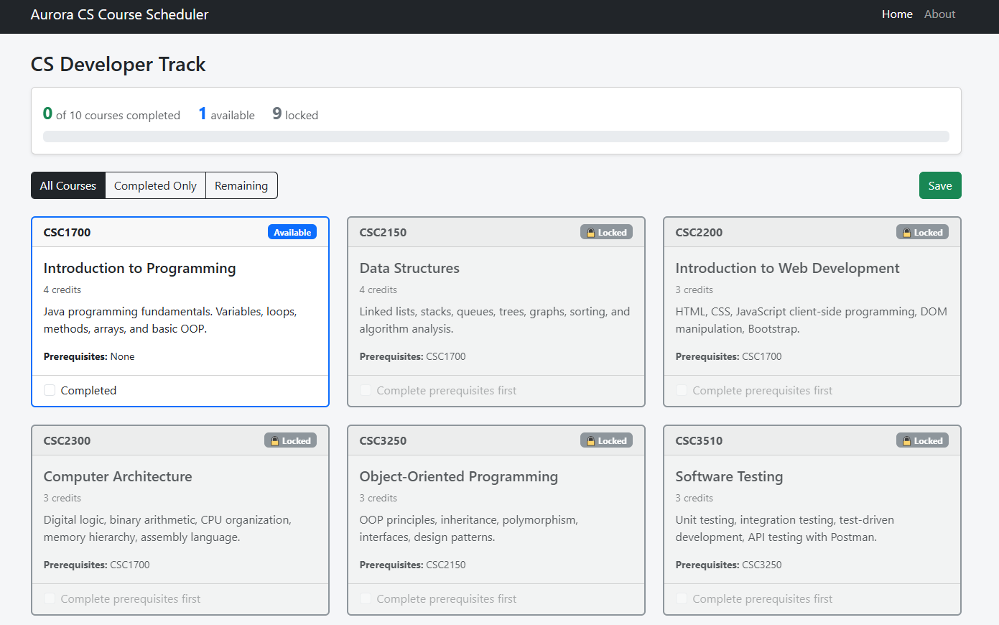
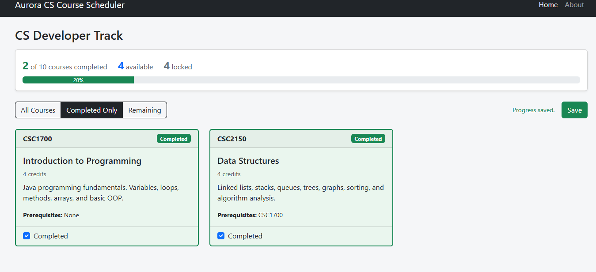
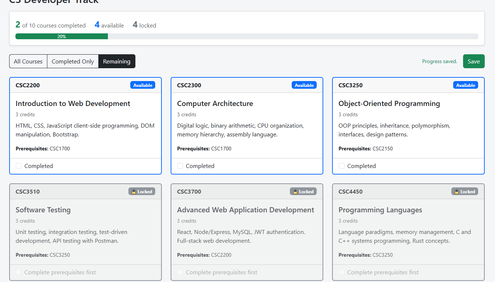
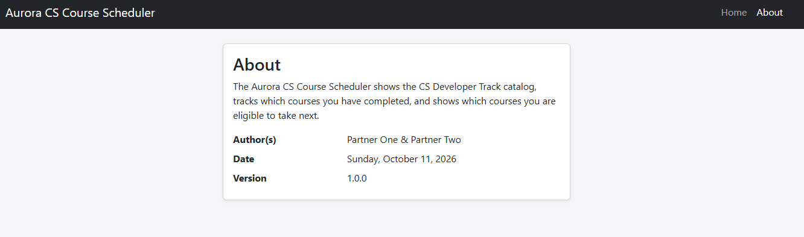

# CSC3700 — Advanced Web Application Development

## Semester Project — Aurora CS Course Scheduler

Fall 2026  |  Prof. Lash  |  Pairs

## 1. Project Overview

Build a full-stack web application across three milestones this semester, working in teams of two. The application is an Aurora CS Course Scheduler — a tool that displays the Computer Science course catalog, tracks which courses a student has completed, and shows which courses they are eligible to take next based on prerequisites.

Each milestone adds one technical layer. By the final submission you will have a complete, working application with a React front end, a Node/Express REST API, a MySQL database, and JWT authentication. There are 3 Milestones:

1. Milestone 1 (M1) will complete the UI working with a browser and JSON Webserver.
2. Milestone 2 (M2) you will add user accounts so every student has their own data.
3. Milestone 3 (M3) you add authentication so students log in and see only their own history.



### What the application must do for M1

1. Fetch all course data from JSON Server using the useFetch hook. No course data is hardcoded in the application.
2. Display the full catalog showing each course's number, title, credits, description, and prerequisite course numbers.
3. Each course shows its completion status. A student can check or uncheck a course to toggle it.
4. A course cannot be marked **Completed** unless every course in its prerequisites array is already marked Completed. Enforce this — do not just display a warning.
5. If a completed course is unchecked, any course that listed it as a prerequisite is automatically unchecked as well (cascade).
6. Each course is labeled by its current state: **Completed, Available** (all prereqs met), or **Locked** (one or more prereqs not met). The three states are visually distinct.
7. A filter control lets the student switch between three views: **All Courses, Completed Only**, and **Remaining** (not yet completed).





8. A **Save button** writes the current completion state to localStorage so it persists across page refreshes.
9. The app has a **navbar** with React Router. The course list renders at the / route.
10. An **About page** at /about displays the author's name, the current date, and the application version number.



11. A progress summary is always visible showing: **number of courses completed, number available, and number locked**. These numbers update immediately when completion state changes. They are derived from state — not stored separately.

| Milestone | What You Build | Tech | Due |
|---|---|---|---|
| M1 | Course catalog display with prerequisite tracking | React + JSON Server | Mon Oct 19 |
| M2 | Replace JSON Server with a real Express API + MySQL. Add user accounts so each student has their own completion history. | Node/Express + MySQL + Sequelize | Mon Nov 9 |
| M3 | Add login and authentication. Students log in to see and update only their own completion history. Protected API routes reject unauthenticated requests. | JWT Auth + protected routes | Mon Dec 1 |
| Final | Polished complete application, class presentation | All layers | Mon Dec 8 |

> Projects are completed in pairs. Both partners must contribute — GitHub commit history is reviewed as part of grading. Exams are individual.

> ⚠️  Late submissions are not accepted. No extensions. Start immediately.

## 2. The Course Data

Your JSON Server database will contain the Aurora CS Developer Track courses. This is the actual curriculum your classmates are working through. Each course has an id, course number, title, credits, description, and a prerequisites array listing the ids of courses that must be completed first.

Create a db/ folder at your project root and add db.json with the following data:

```json
// db/db.json
{
  "courses": [
    {
      "id": 1,
      "number": "CSC1700",
      "title": "Introduction to Programming",
      "credits": 4,
      "description": "Java programming fundamentals. Variables, loops, methods, arrays, and basic OOP.",
      "prerequisites": []
    },
    {
      "id": 2,
      "number": "CSC2150",
      "title": "Data Structures",
      "credits": 4,
      "description": "Linked lists, stacks, queues, trees, graphs, sorting, and algorithm analysis.",
      "prerequisites": [1]
    },
    {
      "id": 3,
      "number": "CSC2200",
      "title": "Introduction to Web Development",
      "credits": 3,
      "description": "HTML, CSS, JavaScript client-side programming, DOM manipulation, Bootstrap.",
      "prerequisites": [1]
    },
    {
      "id": 4,
      "number": "CSC2300",
      "title": "Computer Architecture",
      "credits": 3,
      "description": "Digital logic, binary arithmetic, CPU organization, memory hierarchy, assembly language.",
      "prerequisites": [1]
    },
    {
      "id": 5,
      "number": "CSC3250",
      "title": "Object-Oriented Programming",
      "credits": 3,
      "description": "OOP principles, inheritance, polymorphism, interfaces, design patterns.",
      "prerequisites": [2]
    },
    {
      "id": 6,
      "number": "CSC3510",
      "title": "Software Testing",
      "credits": 3,
      "description": "Unit testing, integration testing, test-driven development, API testing with Postman.",
      "prerequisites": [5]
    },
    {
      "id": 7,
      "number": "CSC3700",
      "title": "Advanced Web Application Development",
      "credits": 3,
      "description": "React, Node/Express, MySQL, JWT authentication. Full-stack web development.",
      "prerequisites": [3]
    },
    {
      "id": 8,
      "number": "CSC4450",
      "title": "Programming Languages",
      "credits": 3,
      "description": "Language paradigms, memory management, C and C++ systems programming, Rust concepts.",
      "prerequisites": [5]
    },
    {
      "id": 9,
      "number": "CSC4500",
      "title": "Database Systems",
      "credits": 3,
      "description": "Relational databases, SQL, normalization, transactions, database design.",
      "prerequisites": [2]
    },
    {
      "id": 10,
      "number": "CSC4990",
      "title": "Capstone Project",
      "credits": 3,
      "description": "Semester-long team software project. Real client, full development lifecycle.",
      "prerequisites": [6, 7]
    }
  ]
}
```

Start JSON Server with:

```bash
npx json-server --watch db/db.json --port 3333
```

> All courses are served at http://localhost:3333/courses. A single course is at http://localhost:3333/courses/1.

## 3. M1 Architecture

M1 is a React front end only. There is no custom back end. JSON Server acts as a stand-in REST API serving your course data. Your React app reads from JSON Server exactly the way it will read from your real Express API in M2 — the only thing that changes in M2 is the server behind the URL.

| Layer | Technology | Runs on |
|---|---|---|
| Front end | React + Vite + Bootstrap | http://localhost:5173 |
| Mock API | JSON Server | http://localhost:3333 |
| Data | db/db.json | Local file — JSON Server reads it |

Required project structure:

```text
course-scheduler/
  db/                        <- JSON Server database
    db.json
  src/
    assets/                  <- images, icons, CSS files
    components/              <- reusable UI components
      CourseCard.jsx
      CourseList.jsx
      NavBar.jsx
      ProgressSummary.jsx
    hooks/                   <- custom React hooks
      useFetch.js
    pages/                   <- one file per route
      HomePage.jsx
      AboutPage.jsx
    App.jsx
    main.jsx
  .env
  .gitignore
  package.json
```

```ini
# .env
VITE_API_BASE_URL=http://localhost:3333
```

> Use import.meta.env.VITE_API_BASE_URL in every fetch call. Never hardcode http://localhost:3333 in your components.

## 4. M1 Requirements

Your application must meet all of the following requirements to receive full credit.

### Course List Display

1. Fetch all courses from **JSON Server using your `useFetch` hook** on component mount. No course data is hardcoded.
2. Display all 10 courses in a card or table layout.
3. Each course must show: **course number, title, credits, description, and prerequisites** as course numbers (e.g., CSC1700), not raw ids. Courses with no prerequisites display None.
4. Show a **loading indicator** while the fetch is in progress (isPending).
5. Show an error message if the fetch fails.

### Completion and Filtering

1. Each course has a **checkbox or toggle** that marks it as **Completed**.
2. A course cannot be marked **Completed** unless every course in its prerequisites array is already **Completed**. Note you must enforce that clicking the checkbox on a Locked course does nothing.
3. If a **Completed** course is **unchecked**, any course that listed it as a prerequisite is automatically **unchecked** as well (cascade).
4. Each course is labeled with its current state: **Completed, Available** (all prereqs met), or **Locked** (one or more prereqs not met).
5. The three states are visually distinct — use color, badges, or styling to make the difference obvious at a glance.
6. A filter control lets the student switch between three views: **All Courses, Completed Only, and Remaining** (not yet completed).
7. A **Save** button writes the current completion state to localStorage. On next page load, the saved state is restored.

### Availability Logic

1. A course is available if all of its prerequisite course ids are in the completed list.
2. Courses with no prerequisites (e.g., **CSC1700**) are always available.
3. The available/locked status updates immediately on screen when any completion state changes — no page reload required.

### Navigation

1. App has a navbar using **React Router** with at minimum a Home link and an About link.
2. The course list renders at the / route.
3. The **About page** renders at /about and displays the author's name, the current date, and the application version number.

### Progress Summary

1. A summary bar or header **is always visible on the course list** page showing: X of 10 courses completed, X available, and X locked.
2. All three counts are derived from the courses array and completed state using .filter() — they are not stored in separate state variables.
3. The counts update immediately whenever the student checks or unchecks a course.

### GitHub

1. Project is in a GitHub repository shared with Prof. Lash.
2. Both partners have commits in the history.
3. node_modules and .env are in .gitignore and not committed.
4. README.md explains how to run the project (npm install, start JSON Server, npm run dev).

## 5. How to Compute Availability

A course is available when every id in its prerequisites array appears in the completed array. Here is the logic in plain JavaScript:

```javascript
// completed is an array of course ids the student has marked done
// course.prerequisites is an array of ids that must be completed first

const isAvailable = (course, completed) => {
  return course.prerequisites.every(prereqId => completed.includes(prereqId))
}
```

Call this function when rendering each CourseCard to decide whether to show the Available badge. Because this runs during render, the display updates automatically whenever completed state changes.

> A course with an empty prerequisites array passes .every() automatically — every() on an empty array always returns true. So CSC1700 is always available without any special case.

## 6. Grading Rubric

| Requirement | Points |
|---|---|
| The correct architecture is used that includes fetching the course list from JSON Server using useFetch, displays all 10 courses. | 10 |
| Each course shows number, title, credits, description, prerequisites as course numbers | 10 |
| Loading and error states handled and displayed | 5 |
| Cannot mark Completed unless all prerequisites are already Completed (enforced) | 15 |
| Cascade uncomplete — unchecking a course automatically unchecks dependent courses | 10 |
| Three states labeled and visually distinct: Completed, Available, Locked | 5 |
| Filter control: All / Completed Only / Remaining | 10 |
| Save button persists completion state to localStorage; state restored on reload | 10 |
| Availability updates immediately on screen with no page reload | 5 |
| Progress summary showing completed / available / locked counts, derived from state | 5 |
| React Router navbar with Home and About links; About page shows author, date, version | 5 |
| GitHub — repo shared, both partners have commits, .env and node_modules excluded, README present | 10 |
| **TOTAL** | **100** |

> **Availability logic that does not actually check prerequisites earns zero points for the Completed enforcement, cascade, and state-label rows regardless of visual styling.**

## 7. Submission

- Due: Monday October 19 before class (11:59 PM Sunday night).
- Submit on Brightspace: GitHub repository URL.
- Both partners submit the same URL.
- Prof. Lash will clone and run your project. If npm install + JSON Server + npm run dev does not produce a working app, points will be deducted.

> ⚠️  If your README is missing or incorrect and the project does not run, that is on you. Test the run instructions yourself before submitting.

---

*CSC3700  |  Aurora University  |  Fall 2026  |  Prof. Lash  |  dlash@aurora.edu*
