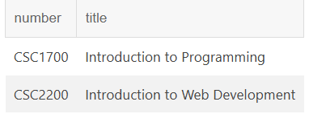
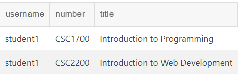
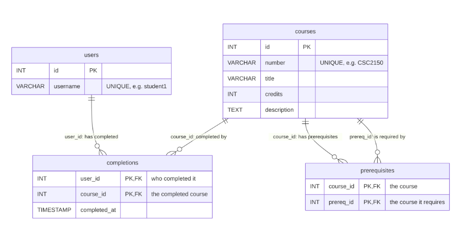

# CSC3700 — Advanced Web Application Development

## Semester Project — Aurora CS Course Scheduler, Milestone 2

## 1. Milestone 2 Overview

In M1:

- React.js based Course Scheduler UI in React.
- Course data from JSON Server
- and completion state was saved in the browser with localStorage.

Not a real application. Clearing the browser wipes the data out, and the data never leaves your machine.

In M2 you will

- replace JSON Server with your own Node/Express API backed by a MySQL database. Course data and completion state both live in the database.
- Your React app keeps every M1 feature. What changes is where the data comes from and where it is saved.

M2 has two halves:

- **The server.** An Express API using the mysql2 pool and raw SQL, exactly as in Lesson 4. It serves courses and completions, and it supports full CRUD on courses.
- **The client.** Your M1 React app, rewired to talk to your Express server. The Save button now writes to the database instead of localStorage.

Start the server half first. You already know how to build Express routes and run SQL with the mysql2 pool. Connecting React to your own backend is covered in Lesson 5, so plan to have your API working and tested by then.

| Milestone | What You Build | Tech | Due |
|---|---|---|---|
| M1 | Course catalog display with prerequisite tracking | React + JSON Server | Fri Oct 30 |
| M2 | Replace JSON Server with your own Express API + MySQL. Course data and completion state are stored in the database. | Node/Express + mysql2 + MySQL | Mon Nov 16 |
| M3 | Add user accounts and login. Each student logs in and sees and updates only their own completion history. Protected API routes reject unauthenticated requests. | Users + JWT Auth | TBA |
| Final | Polished complete application, class presentation | All layers | TBA |

Projects are completed in the same pairs as M1. Both partners must contribute. GitHub commit history is reviewed as part of grading.

> ⚠️ Late submissions are not accepted. No extensions. Start immediately.

## 2. What Changes from M1

| Area | M1 | M2 |
|---|---|---|
| Course data | db/db.json served by JSON Server on port 3333 | MySQL tables served by your Express API on port 3000 |
| Completion state | Saved to localStorage in the browser | Saved to the completions table in MySQL |
| Prerequisite enforcement | Front end only | Front end AND server. The server rejects an invalid completion list. |
| VITE_API_BASE_URL | http://localhost:3333 | http://localhost:3000 |
| Fetch paths | /courses | /api/courses and /api/completions |
| Progress summary | X of 10 completed | X of N completed, where N comes from the data (courses can be added or deleted) |
| About page version | 1.x | 2.0.0 |

Everything else from M1 must still work: the three course states, prerequisite enforcement on the checkbox, cascade uncheck, the filter control, the progress summary, React Router, and the About page.

M2 has a users table but no login. The server uses one hardcoded user (id 1) for every request. In M3, login replaces that hardcoded id with the logged-in user's id.

## 3. M2 Architecture

You now run two programs at the same time in two terminals: the Express server and the Vite dev server. The React app runs in the browser and calls your Express API. Express runs SQL against your team database on the class server.

| Layer | Technology | Runs on |
|---|---|---|
| Front end | React + Vite + Bootstrap | http://localhost:5173 |
| API | Node + Express + mysql2 (pool) | http://localhost:3000 |
| Database | MySQL, your team database | Class MySQL server |

**Required project structure.** Keep your M1 repository and add a `server/` folder. The React app stays where it is. Delete the old `db/` folder once your app no longer uses JSON Server.

```
course-scheduler/
    server/                      <- NEW: Express API
        sql/
            schema.sql           <- creates the three tables
            seed.sql             <- loads courses, prerequisites, one user,
                                     and sample completions
        routes/
            courses.js           <- /api/courses routes
            completions.js       <- /api/completions routes
        util/
            database.js          <- mysql2 pool, exported (same as Lesson 4)
            courseData.js        <- GIVEN: two helper functions (Section 7)
            validateCourse.js    <- shared POST/PUT validation
        server.js                <- creates app, CORS, mounts routers
        requests.http            <- tests for every route
        .env                     <- DB credentials (NOT committed)
        .env.example             <- same keys, no real values (committed)
        package.json
    src/
        assets/
        components/
            CourseCard.jsx
            CourseList.jsx
            NavBar.jsx
            ProgressSummary.jsx
        hooks/
            useFetch.js
        pages/
            HomePage.jsx
            AboutPage.jsx
        App.jsx
        main.jsx
    .env                         <- VITE_API_BASE_URL
    .gitignore
    package.json
    README.md
```

**The two .env files.** Your team database values come from the credential sheet Prof. Lash gives each team:

```
// .env  (project root, used by React)
VITE_API_BASE_URL=http://localhost:3000

// server/.env  (used by Express)
PORT=3000
DB_HOST=from_your_team_sheet
DB_USER=from_your_team_sheet
DB_PASSWORD=from_your_team_sheet
DB_NAME=from_your_team_sheet
CLIENT_ORIGIN=http://localhost:5173
```

Use `cors({ origin: process.env.CLIENT_ORIGIN })` exactly as in Lesson 5. Do not use `cors()` with no options.

## 4. The Database

Four tables: courses and users hold the main data. prerequisites and completions hold ids that point at them.

| Table | Columns | Purpose |
|---|---|---|
| courses | id, number, title, credits, description | One row per course |
| prerequisites | course_id, prereq_id | One row per prerequisite. CSC4990 has two rows. |
| completions | user_id, course_id, completed_at | One row per completed course |
| users | id, username | one row per student, (with only one user in M2) |

Create `server/sql/schema.sql` with the following. It drops and recreates the tables so you can rerun it at any time to reset your database.

```sql
-- server/sql/schema.sql
DROP TABLE IF EXISTS completions;
DROP TABLE IF EXISTS prerequisites;
DROP TABLE IF EXISTS courses;
DROP TABLE IF EXISTS users;

CREATE TABLE users (
    id       INT AUTO_INCREMENT PRIMARY KEY,
    username VARCHAR(50) NOT NULL UNIQUE
);

CREATE TABLE courses (
    id          INT AUTO_INCREMENT PRIMARY KEY,
    number      VARCHAR(10)  NOT NULL UNIQUE,
    title       VARCHAR(100) NOT NULL,
    credits     INT          NOT NULL,
    description TEXT
);

CREATE TABLE prerequisites (
    course_id INT NOT NULL,
    prereq_id INT NOT NULL,
    PRIMARY KEY (course_id, prereq_id),
    FOREIGN KEY (course_id) REFERENCES courses(id) ON DELETE CASCADE,
    FOREIGN KEY (prereq_id) REFERENCES courses(id) ON DELETE CASCADE
);

CREATE TABLE completions (
    user_id      INT NOT NULL,
    course_id    INT NOT NULL,
    completed_at TIMESTAMP DEFAULT CURRENT_TIMESTAMP,
    PRIMARY KEY (user_id, course_id),
    FOREIGN KEY (user_id)   REFERENCES users(id)   ON DELETE CASCADE,
    FOREIGN KEY (course_id) REFERENCES courses(id) ON DELETE CASCADE
);
```

Create `server/sql/seed.sql` with the same ten courses you used in M1:

```sql
-- server/sql/seed.sql
INSERT INTO courses (id, number, title, credits, description) VALUES
(1,  'CSC1700', 'Introduction to Programming', 4,
     'Java programming fundamentals. Variables, loops, methods, arrays, and basic OOP.'),
(2,  'CSC2150', 'Data Structures', 4,
     'Linked lists, stacks, queues, trees, graphs, sorting, and algorithm analysis.'),
(3,  'CSC2200', 'Introduction to Web Development', 3,
     'HTML, CSS, JavaScript client-side programming, DOM manipulation, Bootstrap.'),
(4,  'CSC2300', 'Computer Architecture', 3,
     'Digital logic, binary arithmetic, CPU organization, memory hierarchy, assembly language.'),
(5,  'CSC3250', 'Object-Oriented Programming', 3,
     'OOP principles, inheritance, polymorphism, interfaces, design patterns.'),
(6,  'CSC3510', 'Software Testing', 3,
     'Unit testing, integration testing, test-driven development, API testing with Postman.'),
(7,  'CSC3700', 'Advanced Web Application Development', 3,
     'React, Node/Express, MySQL, JWT authentication. Full-stack web development.'),
(8,  'CSC4450', 'Programming Languages', 3,
     'Language paradigms, memory management, C and C++ systems programming, Rust concepts.'),
(9,  'CSC4500', 'Database Systems', 3,
     'Relational databases, SQL, normalization, transactions, database design.'),
(10, 'CSC4990', 'Capstone Project', 3,
     'Semester-long team software project. Real client, full development lifecycle.');

INSERT INTO prerequisites (course_id, prereq_id) VALUES
(2, 1), (3, 1), (4, 1),
(5, 2),
(6, 5),
(7, 3),
(8, 5),
(9, 2),
(10, 6), (10, 7);

-- One user for M2 -- gets id 1
INSERT INTO users (username) VALUES ('student1');

-- student1 has completed CSC1700 and CSC2200
INSERT INTO completions (user_id, course_id) VALUES (1, 1), (1, 3);
```

Running these scripts against your team database is demonstrated in class. Run schema.sql first, then seed.sql.

### Check – A few queries to practice and check the DB

**1. Did everything load?**

```sql
SELECT
    (SELECT COUNT(*) FROM courses)       AS courses,
    (SELECT COUNT(*) FROM prerequisites) AS prereq_rows,
    (SELECT COUNT(*) FROM users)         AS users,
    (SELECT COUNT(*) FROM completions)   AS completed;
```

Expected: 10, 10, 1, 2. Any other numbers mean a script failed partway through. Rerun schema.sql, then seed.sql.

**2. Which course requires which?**

```sql
SELECT c.number AS course, p.number AS requires
FROM prerequisites pr
JOIN courses c ON pr.course_id = c.id
JOIN courses p ON pr.prereq_id = p.id
ORDER BY c.number;
```

Expected: 10 rows, with CSC4990 listed twice (it requires CSC3510 and CSC3700). The courses table is joined twice, once as the course and once as its prerequisite, which turns the ids in the link table back into readable course numbers.

| course | requires |
|---|---|
| CSC2150 | CSC1700 |
| CSC2200 | CSC1700 |
| CSC2300 | CSC1700 |
| CSC3250 | CSC2150 |
| CSC3510 | CSC3250 |
| CSC3700 | CSC2200 |
| CSC4450 | CSC3250 |
| CSC4500 | CSC2150 |
| CSC4990 | CSC3510 |
| CSC4990 | CSC3700 |

**3. What is marked completed?**

```sql
SELECT c.number, c.title
FROM completions co
JOIN courses c ON co.course_id = c.id;
```

Expected: CSC1700 and CSC2200.



**4. Whose completions are they?**

```sql
SELECT u.username, c.number, c.title
FROM completions co
JOIN users   u ON co.user_id   = u.id
JOIN courses c ON co.course_id = c.id;
```



## 5. The API

All routes start with `/api`. Every route returns JSON. Use the status codes listed here.

| Method | Route | Purpose | Success | Errors |
|---|---|---|---|---|
| GET | /api/courses | All courses, each with a prerequisites array | 200 | |
| GET | /api/courses/:id | One course with its prerequisites array | 200 | 404 |
| POST | /api/courses | Create a course (and its prerequisite rows) | 201 + new course | 400 |
| PUT | /api/courses/:id | Update a course and replace its prerequisites | 200 + updated course | 400, 404 |
| DELETE | /api/courses/:id | Delete a course | 200 + deleted course | 404 |
| GET | /api/completions | Array of completed course ids | 200 | |
| PUT | /api/completions | Replace the completed list with the array sent | 200 + saved array | 400 |

**Course shape.** GET /api/courses must return exactly the same shape your M1 app already reads from JSON Server. Your React components should not need to change how they read a course.

```json
[
  {
    "id": 2,
    "number": "CSC2150",
    "title": "Data Structures",
    "credits": 4,
    "description": "Linked lists, stacks, queues, trees, graphs, ...",
    "prerequisites": [1]
  },
  ...
]
```

**Completions shape.** The client sends and receives a plain array of course ids, the same array your M1 completed state already holds.

```
GET /api/completions      ->  [1, 3]

PUT /api/completions
Content-Type: application/json

[1, 3, 2]                 ->  200  [1, 2, 3]
```

## 6. M2 Requirements

Your application must meet all of the following requirements to receive full credit.

### 6.1 Database

- schema.sql and seed.sql are committed in server/sql/ and run without errors against an empty database.
- Foreign keys are defined exactly as in Section 4, so deleting a course automatically removes its prerequisite and completion rows.

### 6.2 Express Server

- server.js creates the app, enables CORS restricted to CLIENT_ORIGIN and express.json(), and mounts the course and completion routers under /api.
- Routes live in routes/courses.js and routes/completions.js using express.Router(). No routes are defined directly in server.js.
- util/database.js creates one mysql2/promise pool and exports it, exactly as in Lesson 4. Routes import the pool; they do not create their own connections.
- util/courseData.js contains the two given helper functions from Section 7.1, and the routes use them.
- POST and PUT course routes share one validateCourse function in util/validateCourse.js (the Lesson 4 validateBook pattern).
- Database credentials come from server/.env. server/.env.example is committed with the same keys and placeholder values.
- Every query that uses a value from the request uses `?` placeholders. No SQL is built by concatenating request values into a string.
- Every route catches database errors and responds with status 500 and a JSON error message instead of crashing the server.

### 6.3 Course API

- GET /api/courses returns all courses with a prerequisites array of ids (Section 5 shape). Use getCoursesWithPrereqs.
- GET /api/courses/:id returns one course in the same shape, or 404 if it does not exist.
- POST /api/courses accepts number, title, credits, description, and a prerequisites array. It inserts the course, then one prerequisites row per id, and responds 201 with the new course in the Section 5 shape.
- PUT /api/courses/:id updates the course fields, deletes its old prerequisite rows, and inserts the new ones. Responds 200 with the updated course, or 404.
- DELETE /api/courses/:id deletes the course and responds 200 with the deleted course (fetch it first, as in Lesson 4), or 404 if it does not exist.
- POST and PUT respond 400 if number, title, or credits is missing.

### 6.4 Completion API

- GET /api/completions returns an array of completed course ids.
- PUT /api/completions replaces the completed list with the array sent, using the given replaceCompletions helper, and responds 200 with the saved array.
- The server enforces prerequisites on PUT: if any course in the array has a prerequisite that is not also in the array, respond 400 and save nothing. Never trust the client.
- routes/completions.js defines `const USER_ID = 1` at the top, with the comment `// M3: replaced by the logged-in user's id`. GET uses `WHERE user_id = ?` with USER_ID, and PUT passes USER_ID to replaceCompletions.

### 6.5 React Front End

- JSON Server is gone. All data comes from your Express API through VITE_API_BASE_URL. Course data is still loaded with your useFetch hook.
- On page load the completed list comes from GET /api/completions, not localStorage. The app copies it into state so the checkboxes can change it (Section 7.4).
- The Save button sends the current completed array to PUT /api/completions and shows a success or error message. A 400 shows the server's error message. Completions are no longer stored in localStorage.
- After Save, reloading the page shows the saved state.
- All M1 features still work: three course states, enforced checkbox, cascade uncheck, filter, progress summary (now X of N), navbar, and About page (version 2.0.0).

### 6.6 Testing

- server/requests.http (WebStorm HTTP Client) contains at least one request for every route in Section 5.
- It also contains at least one request for each error case: a 404 on a course, a 400 on a course POST, and a 400 on a completions PUT that breaks a prerequisite.

### 6.7 GitHub

- Same repository as M1, still shared with Prof. Lash. Both partners have M2 commits.
- node_modules, .env, and server/.env are in .gitignore and not committed.
- README.md explains how to run both halves: create server/.env from .env.example, run schema.sql and seed.sql, start the server (npm install, npm run dev inside server/), then start the client (npm install, npm run dev at the root).

## 7. Implementation Notes

### 7.1 Given code: util/courseData.js

Two pieces of M2 go beyond what we covered in class

- turning rows from two tables into one prerequisites array,
- and replacing a whole list of rows at once.

Use this file as written. You are graded on using it correctly, not on writing it.

```js
// server/util/courseData.js
// GIVEN CODE -- use as written

// Returns courses in the Section 5 shape: each course has a prerequisites array.
// Call with no id to get all courses (an array).
// Call with an id to get one course (an object), or null if it does not exist.
async function getCoursesWithPrereqs(pool, id) {
    let courses
    if (id === undefined) {
        [courses] = await pool.query('SELECT * FROM courses ORDER BY id')
    } else {
        [courses] = await pool.query('SELECT * FROM courses WHERE id = ?', [id])
    }

    const [prereqs] = await pool.query(
        'SELECT course_id, prereq_id FROM prerequisites'
    )

    const result = courses.map(course => ({
        ...course,
        prerequisites: prereqs
            .filter(p => p.course_id === course.id)
            .map(p => p.prereq_id)
    }))

    if (id === undefined) return result
    return result.length > 0 ? result[0] : null
}

// Replaces this user's completions with the course ids in courseIds.
async function replaceCompletions(pool, userId, courseIds) {
    await pool.query('DELETE FROM completions WHERE user_id = ?', [userId])

    if (courseIds.length > 0) {
        const rows = courseIds.map(id => [userId, id])   // [1, 3] becomes [[1,1], [1,3]]
        await pool.query('INSERT INTO completions (user_id, course_id) VALUES ?', [rows])
    }
}
module.exports = { getCoursesWithPrereqs, replaceCompletions }
```

| Code | What it means |
|---|---|
| `SELECT course_id, prereq_id FROM prerequisites` | Reads every prerequisite row at once. With ten courses this is one small query instead of ten. |
| `...course` | Copies every column of the course row (id, number, title, credits, description) into a new object. |
| `prereqs.filter(p => p.course_id === course.id)` | Keeps only the prerequisite rows that belong to this course. |
| `.map(p => p.prereq_id)` | Turns those rows into a plain array of ids, e.g. [6, 7] for CSC4990. |
| `DELETE FROM completions` | Removes only this user's old list (WHERE user_id = ?), then inserts the new one. |
| `VALUES ?` with `[rows]` | mysql2 expands a nested array into many rows in one INSERT. This only works with pool.query(), not pool.execute(). |
| `if (courseIds.length > 0)` | INSERT with zero rows is a SQL error. An empty array means "nothing completed," so only the DELETE runs. |

Using it in a route:

```js
const { getCoursesWithPrereqs } = require('../util/courseData')

router.get('/courses', async (req, res) => {
    try {
        const courses = await getCoursesWithPrereqs(pool)
        res.json(courses)
    } catch (err) {
        res.status(500).json({ error: err.message })
    }
})
```

### 7.2 Saving prerequisite rows in POST and PUT

A course and its prerequisites are stored in two different tables, so creating or updating a course takes more than one SQL statement.

**POST: add a new course.** CSC4600 Cloud Computing is not in the seed data; it's a made-up course for testing. It requires CSC3250 (id 5) and CSC4500 (id 9).

```
POST {{baseUrl}}/courses
Content-Type: application/json

{ "number": "CSC4600", "title": "Cloud Computing", "credits": 3,
  "description": "Test course", "prerequisites": [5, 9] }
```

The route runs:

```sql
INSERT INTO courses (number, title, credits, description) VALUES ('CSC4600', 'Cloud Computing', 3, 'Test course');
-- MySQL gives the new course id 11 (result.insertId)
INSERT INTO prerequisites (course_id, prereq_id) VALUES (11, 5);
INSERT INTO prerequisites (course_id, prereq_id) VALUES (11, 9);
```

Then it sends back `getCoursesWithPrereqs(pool, 11)`, so the response includes `"prerequisites": [5, 9]`.

**PUT: change an existing course.** In the seed data, CSC3700 (id 7) requires only CSC2200 (id 3). This request changes it to require CSC2200 and CSC3250 (id 5).

```
PUT {{baseUrl}}/courses/7
Content-Type: application/json

{ "number": "CSC3700", "title": "Advanced Web Application Development", "credits": 3,
  "description": "React, Node/Express, MySQL, JWT authentication.", "prerequisites": [3, 5] }
```

The route runs:

```sql
UPDATE courses SET number = 'CSC3700', title = '...', credits = 3, description = '...' WHERE id = 7;
DELETE FROM prerequisites WHERE course_id = 7;        -- removes (7, 3)
INSERT INTO prerequisites (course_id, prereq_id) VALUES (7, 3);
INSERT INTO prerequisites (course_id, prereq_id) VALUES (7, 5);
```

Then it sends back `getCoursesWithPrereqs(pool, 7)`.

| Rows for course 7 before | Rows for course 7 after |
|---|---|
| (7, 3) | (7, 3), (7, 5) |

The PUT deletes every old row and then inserts the full new list. The client only sends the new list, so the route doesn't need to work out what changed.

If the UPDATE changes zero rows (`result.affectedRows === 0`), the course doesn't exist. Return 404 and skip the DELETE and INSERT, as in the Lesson 4 books PUT.

In both routes, use `?` placeholders in the real code. The values are written into the SQL above only so you can see what runs.

### 7.3 Validating completions on the server

This is the same rule as your M1 isAvailable function, applied to the whole array. Every completed course must have all of its prerequisites in the completed array.

```js
// courses: array in the Section 5 shape, completed: array of ids
const isValidCompletionSet = (courses, completed) => {
    return completed.every(id => {
        const course = courses.find(c => c.id === id)
        return course && course.prerequisites.every(p => completed.includes(p))
    })
}
```

Why check on the server if the React app already prevents it? Because anyone can send a PUT request directly with the HTTP Client and skip your UI entirely. Your requests.http file should prove the server rejects it.

### 7.4 Loading completions into state

useFetch gives you data, but the checkboxes need state they can change. Copy the fetched array into your completed state once it arrives. This is the same pattern Update.jsx uses in Lesson 5 to pre-fill its form.

```js
const { data: savedCompletions } = useFetch(`${BASE_URL}/api/completions`)
const [completed, setCompleted] = useState([])

// NOTE: when the fetch finishes, copy the server's list into editable state
useEffect(() => {
    if (Array.isArray(savedCompletions)) setCompleted(savedCompletions)
}, [savedCompletions])
```

## 8. Grading Rubric

| Requirement | Points |
|---|---|
| Database: schema.sql and seed.sql committed, run cleanly, foreign keys as specified | 10 |
| Express structure: Router files, util/database.js pool, courseData helpers used, shared validateCourse, .env and .env.example, CORS restricted to CLIENT_ORIGIN, ? placeholders, 500 handling | 10 |
| GET /api/courses and GET /api/courses/:id return the Section 5 shape; 404 handled | 10 |
| POST, PUT, DELETE courses work with correct status codes; prerequisite rows saved and replaced; 400 validation | 15 |
| GET and PUT completions; server rejects a completion array that breaks a prerequisite (400, nothing saved) | 15 |
| React reads all data from Express through VITE_API_BASE_URL; JSON Server removed | 10 |
| Completions load from the server into state; Save writes to the server with success/error message; reload shows saved state; no localStorage | 15 |
| All M1 features still work (states, enforcement, cascade, filter, X of N summary, Router, About 2.0.0) | 5 |
| requests.http covers every route plus the three required error cases | 5 |
| GitHub: both partners have M2 commits, .env files excluded, README covers both halves | 5 |
| **TOTAL** | **100** |

Any query that builds SQL by concatenating a request value into the string earns zero for the Express structure row. A completions PUT that saves an invalid array earns zero for the completions row, even if the React app never sends one.

## 9. Submission

- **Due:** Monday November 16 before class (11:59 PM Sunday night).
- Submit on Brightspace: GitHub repository URL.
- Both partners submit the same URL.
- Prof. Lash will clone your repository, create server/.env with his own credentials, run your schema.sql and seed.sql, then start the server and the client using your README. If that does not produce a working app, points will be deducted.

> ⚠️ If your README is missing or incorrect and the project does not run, that is on you. Test the run instructions yourself from a fresh clone before submitting.

## Appendix A: The Database diagram



## Appendix B: Common Database Actions

In M2 the server always uses user id 1 (student1). In M3, login supplies the user id.

> **Note — Reading the queries:** `FROM courses c` gives the table a short nickname, `c`, so `c.number` means "the number column from courses." `JOIN ... ON` connects rows from two tables where the ids match.

**1. Create a new course (POST /api/courses)** — add a course that isn't in the catalog yet, along with the courses it requires.

Example: add a new course, CSC4600 Cloud Computing, which requires CSC3250 (id 5) and CSC4500 (id 9). CSC4600 is made up for testing; it isn't in the seed data.

- Insert the course into courses.
- Read the new course's id from `result.insertId`. With the seed data, it will be 11.
- Insert one row into prerequisites for each required course.

```sql
INSERT INTO courses (number, title, credits, description)
VALUES ('CSC4600', 'Cloud Computing', 3, 'Test course');
-- result.insertId = 11
INSERT INTO prerequisites (course_id, prereq_id) VALUES (11, 5), (11, 9);
```

The order matters. The course has to exist before its prerequisite rows, because the foreign key rejects any id that isn't in courses.

**2. Change a course's prerequisites (PUT /api/courses/:id)** — edit an existing course, for example to add or remove a course it requires.

Example: CSC3700 (id 7) requires only CSC2200 (id 3). Change it to require CSC2200 and CSC3250 (id 5).

```sql
UPDATE courses SET number = ?, title = ?, credits = ?, description = ? WHERE id = 7;
DELETE FROM prerequisites WHERE course_id = 7;
INSERT INTO prerequisites (course_id, prereq_id) VALUES (7, 3), (7, 5);
```

Delete all the old rows, then insert the full new list. The client only sends the new list, so the route doesn't need to work out what changed.

**3. Delete a course (DELETE /api/courses/:id)** — remove a course from the catalog completely

```sql
DELETE FROM courses WHERE id = 5;
```

That's all you run. ON DELETE CASCADE removes every prerequisites and completions row that mentions course 5. That includes rows where course 5 is the requirement, so deleting CSC3250 also removes it as a prerequisite of CSC3510 and CSC4450.

**4. Mark a course completed** — what happens in the database when a student checks a course's checkbox and saves.

The React app already has the course id (course.id), so there's nothing to look up.

```sql
INSERT INTO completions (user_id, course_id) VALUES (1, 2);
```

The database only checks that user 1 and course 2 exist. It does not check prerequisites, so it would accept CSC4990 with nothing else done. That's why your PUT route has to check prerequisites. Inserting the same (user, course) pair twice fails, because the pair is the primary key.

In M2, Save doesn't insert courses one at a time. replaceCompletions deletes all of this user's rows and inserts the current list.

**5. Unmark a course** — what happens in the database when a student unchecks a course they had marked completed, for example because they checked it by mistake, and saves.

```sql
DELETE FROM completions WHERE user_id = 1 AND course_id = 2;
```

The cascade uncheck (unchecking CSC2150 also unchecks the courses that depend on it) happens in React before Save. The database doesn't do it.

**6. Show all courses with their prerequisites (GET /api/courses)** — how the app gets the full catalog to display on the home page.

```sql
SELECT * FROM courses ORDER BY id;
SELECT course_id, prereq_id FROM prerequisites;
```

Read both tables and merge them in JavaScript. That's what the given getCoursesWithPrereqs does. Course data is the same for every user, so there's no user_id here.

*Items 7 and 8 are for exploring in phpMyAdmin. You don't need them in your M2 code.*

**7. Show all courses and whether user 1 completed each one** — the whole catalog with a Yes/No column, the same information the checkboxes show, but done in one SQL query.

```sql
SELECT c.number, c.title,
       IF(co.course_id IS NULL, 'No', 'Yes') AS completed
FROM courses c
LEFT JOIN completions co ON co.course_id = c.id AND co.user_id = 1
ORDER BY c.number;
```

A plain JOIN would show only completed courses. LEFT JOIN keeps every course. When there's no matching completions row, co.course_id is NULL, so the course shows "No". The `co.user_id = 1` goes in the ON clause: in the WHERE clause it would throw away the courses that aren't completed.

In the app, React does the same thing in JavaScript with `completed.includes(course.id)`.

**8. Which prerequisites does user 1 still need for CSC4990?** — The reason a course shows as Locked: the prerequisites the student hasn't completed yet.

```sql
SELECT p.number AS still_needs
FROM prerequisites pr
JOIN courses p ON pr.prereq_id = p.id
WHERE pr.course_id = 10
  AND pr.prereq_id NOT IN (SELECT course_id FROM completions WHERE user_id = 1);
```

If the query returns no rows, every prerequisite is done and CSC4990 is Available. If it returns any, those are what keep it Locked.

---

CSC3700 | Aurora University | Fall 2026 | Prof. Lash
